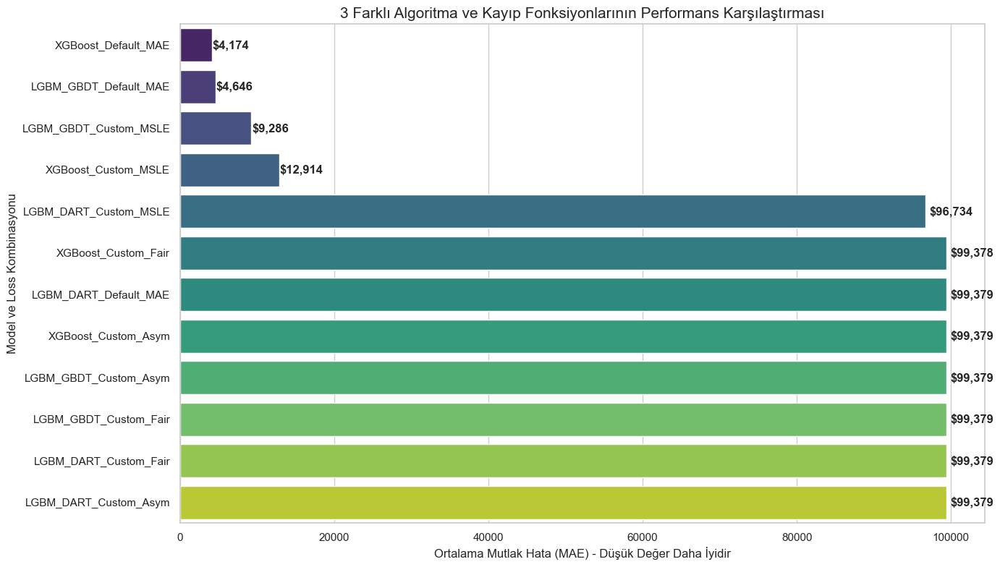

# Glassdoor Salary Prediction with Custom Loss Functions

Predicts the **average annual salary** of data and tech job postings from Glassdoor using company characteristics.

**Dataset:** [Jobs Dataset from Glassdoor](https://www.kaggle.com/datasets/thedevastator/jobs-dataset-from-glassdoor), downloaded automatically with `kagglehub`.

## Pipeline

1. **Cleaning:** salary ranges and hourly wages → annual average, revenue and size bands → ordinal, company age.
2. **Relational imputation:** missing categoricals filled from co-occurrence with job title, sector, location and ownership type.
3. **Augmentation:** noisy synthetic samples for rare job titles and sectors (training set only).
4. **Model × loss benchmark:** XGBoost, LightGBM GBDT, LightGBM DART × MAE, Fair, MSLE, Asymmetric (12 combinations).
5. **Evaluation & explainability:** test metrics, permutation importance.
6. **Imputation:** the champion model fills 214 missing salaries with a prediction range.

## Results

| Metric (test set) | Value |
|---|---:|
| MAE | **$12,460** |
| RMSE | $22,476 |
| R² | **0.655** |

Champion model: **XGBoost with MAE objective**. The most important features are job title, location and headquarters.

   
  
  

**TR:** Glassdoor iş ilanlarından yıllık ortalama maaş tahmini. Veri temizleme, ilişkisel eksik veri doldurma, sentetik veri çoğaltma ve 12 model × kayıp fonksiyonu karşılaştırması. En iyi model XGBoost (MAE): test R² 0,655, MAE ≈ $12.5K.
