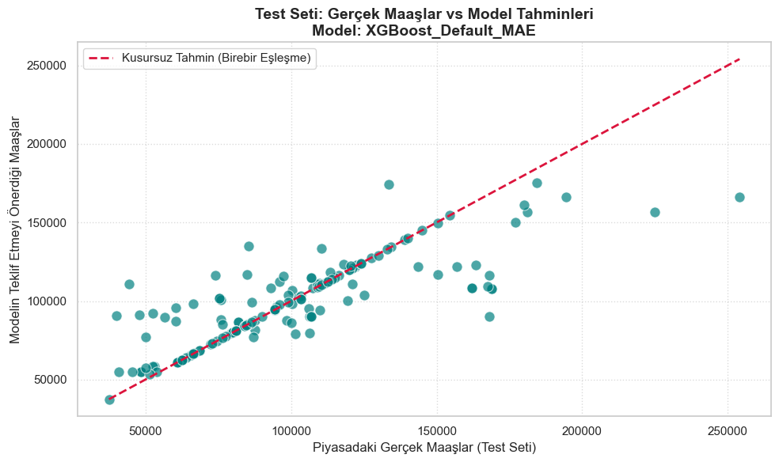
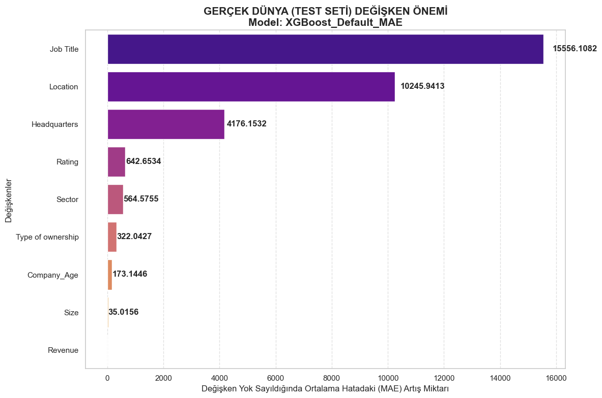

# Machine Learning Projects Portfolio


**🇬🇧 English** · [🇹🇷 Türkçe](#-türkçe)

A collection of supervised learning projects covering **tabular classification, regression with custom loss functions and neural networks**. Each folder is a self-contained project with its own notebook(s).

| # | Project | Task | Techniques | Result |
|---|---|---|---|---|
| 01 | [Dementia severity (CDR) classification](01-dementia-cdr-classification) | Multi-class classification (4 classes) | SMOTE / ADASYN, Random Forest, Gradient Boosting, XGBoost, MLP, HalvingGridSearchCV | **73.3 %** test accuracy (Random Forest) |
| 02 | [Glassdoor salary prediction](02-glassdoor-salary-prediction) | Regression | Relational imputation, synthetic augmentation, **custom loss functions** (Fair, MSLE, asymmetric), XGBoost, LightGBM (GBDT/DART) | **R² = 0.655**, test MAE ≈ **$12.5K** |
| 03 | [MNIST digit classification](03-mnist-neural-network) | Image classification (10 classes) | Dense neural network, layer/node/dropout search | **~98 %** test accuracy |
| 04 | [California housing – deep NN](04-california-housing-dnn) | Regression | Feature crosses, Z-score normalization, linear baseline vs. DNN | DNN beats linear baseline |

---

## 02 · Glassdoor Salary Prediction (highlight)

Predicting the **average annual salary** of data and tech job postings from company characteristics (rating, size, revenue, sector, location, company age).

- Parsed messy salary strings (ranges, `per hour` → annual), revenue and size bands.
- Filled missing categorical values using **co-occurrence patterns** between job title, sector, location and ownership type instead of a plain mode.
- Added **noisy synthetic samples** for rare job titles and sectors to reduce over- and underfitting.
- Benchmarked **12 model × loss combinations** (XGBoost, LightGBM GBDT, LightGBM DART × MAE / Fair / MSLE / Asymmetric).
- Champion: **XGBoost + MAE** → test MAE **$12,460**, RMSE **$22,476**, **R² 0.655**. Used to impute 214 missing salaries with prediction ranges.

<p align="center">
  
  
</p>

## 01 · Dementia Severity (CDR) Classification

Team project from the **Coşkunöz Education Foundation Data Science Bootcamp** (2022). The goal was to predict the global **Clinical Dementia Rating (CDRGLOB)** from demographic, cognitive (MoCA), genetic (APOE) and lifestyle features.

- Imbalanced 4-class target → compared **SMOTE, ADASYN and random oversampling**. ADASYN performed best.
- Tuned models with **HalvingGridSearchCV** and compared them with ROC curves per class.

| Model | Test accuracy |
|---|---:|
| **Random Forest** | **0.733** |
| XGBoost | 0.724 |
| Gradient Boosting | 0.723 |
| MLP Classifier | 0.722 |
| KNN | 0.706 |

> The dataset was provided under a data-use agreement, so it is **not included** and notebook outputs have been cleared.

## Getting started

```bash
git clone https://github.com/4hmetcakmak/ml-projects-portfolio.git
cd ml-projects-portfolio
pip install -r requirements.txt
jupyter notebook
```

---

## 🇹🇷 Türkçe

Sınıflandırma, özel kayıp fonksiyonlu regresyon ve yapay sinir ağları üzerine denetimli öğrenme projelerimden oluşan bir koleksiyon.

- **01 · Demans şiddeti (CDR) sınıflandırması:** Coşkunöz Eğitim Vakfı Veri Bilimi Bootcamp grup projesi. Dengesiz 4 sınıflı hedef için SMOTE/ADASYN karşılaştırması, Random Forest, XGBoost, MLP ve HalvingGridSearchCV. En iyi sonuç **%73,3** doğruluk (Random Forest). Veri seti kullanım sözleşmesi kapsamında olduğu için paylaşılmamıştır.
- **02 · Glassdoor maaş tahmini:** Kirli maaş metinlerinin temizlenmesi, değişkenler arası ilişkiye dayalı eksik veri doldurma, nadir sınıflar için sentetik veri çoğaltma ve **12 farklı model × kayıp fonksiyonu** (XGBoost, LightGBM GBDT/DART × MAE/Fair/MSLE/Asimetrik) karşılaştırması. Şampiyon model: **XGBoost + MAE**, test **R² 0,655**, MAE **≈ $12.5K**.
- **03 · MNIST rakam sınıflandırma:** Katman, nöron sayısı ve dropout denemeleriyle **~%98** test doğruluğu.
- **04 · California konut fiyatları:** Doğrusal model ile derin sinir ağının karşılaştırılması, özellik çaprazlama ve Z-skor normalizasyonu.

---

**Author / Yazar:** Ahmet Çakmak · [GitHub](https://github.com/4hmetcakmak)
